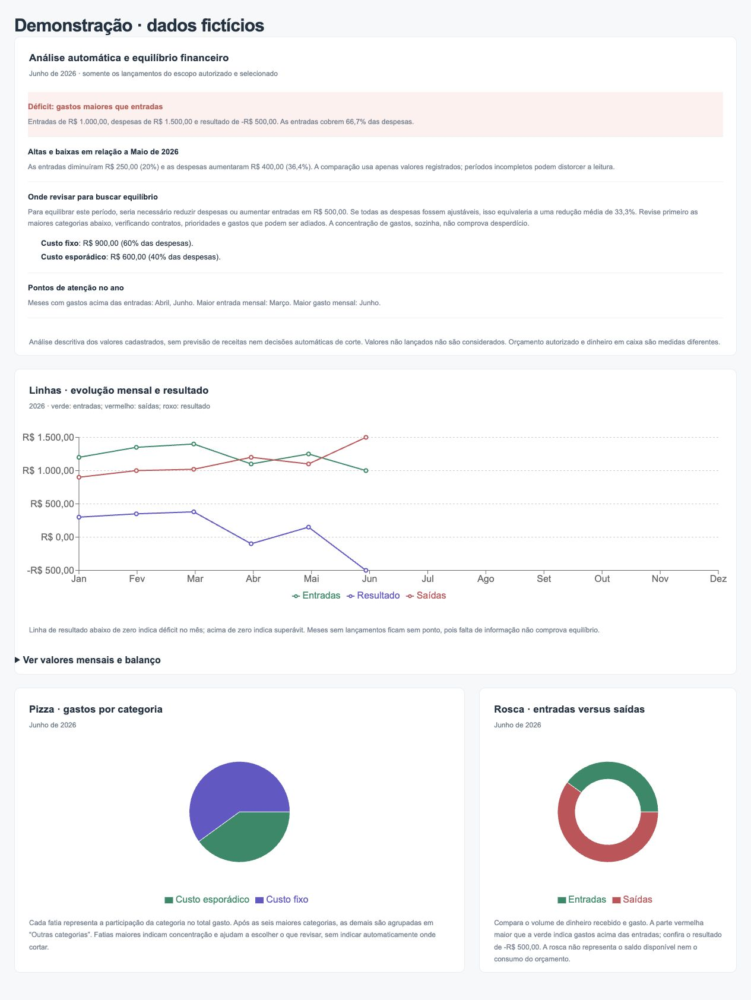

# Igreja de Cristo em Nova Cidade · Financeiro local

Segundo projeto, baseado no sistema original, com banco local SQLite e FastAPI Python. A interface React já está compilada em `dist`. Licença MIT.

Comece por [LEIA-ME-WINDOWS.md](LEIA-ME-WINDOWS.md). O pacote Windows inclui os arquivos de instalação, inicialização e backup. Funciona sem internet após a instalação, no computador da mídia e na rede da igreja. Não há publicação na internet nem acesso externo.

## Desenvolvimento

Python 3.13, `uv sync`, `npm ci`, `npm run build`, `uv run python iniciar.py`.

Dados e configuração ficam fora do repositório. É possível definir `CHURCH_DATA_DIR` para uma pasta temporária de testes. O padrão escuta somente em localhost; o guia explica a ativação restrita da rede local e HTTPS.

Testes: `uv run python -m pytest tests -q` e `npm run test:finance`.

Backups: `uv run python backup.py` cria uma cópia criptografada em uma pasta escolhida, inclusive pasta sincronizada com Drive. A conta Google, sincronização e configuração da rede ficam no computador Windows da igreja.

## Painéis semelhantes a uma ferramenta de BI

Comparações entre entradas e despesas, superávit/déficit, tendências, orçamento e participação por categoria. Filtros de mês, ano e ministério. Os gráficos e relatórios seguem as permissões individuais. Pedidos passam por aprovação e as alterações ficam no histórico de auditoria. Esta edição não pretende reproduzir todos os recursos de SharePoint ou Power BI.

Documentos, integrações, cadastro de eventos e acesso externo ficaram fora desta versão a pedido do responsável. Software e dependências sem assinatura; uso de computador, energia e eventual armazenamento adicional no Drive depende dos recursos da igreja.
